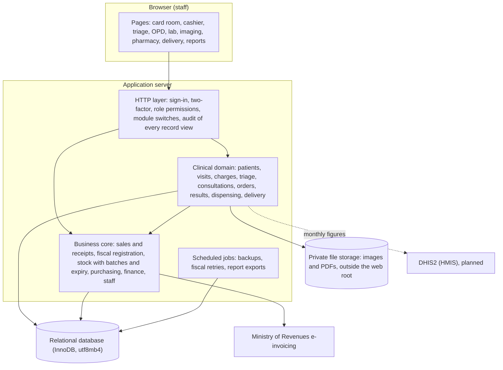

# Architecture

HOROOMED™ is a server-rendered web application. Staff use it in a browser on desktops,
tablets and phones. It needs no installation at the facility beyond a browser and, where
wanted, a receipt printer and a barcode scanner.

## Layers

| Part | Technology |
|---|---|
| Application | PHP and Laravel, organised by domain |
| Pages | Server-rendered Blade templates, Tailwind CSS, Alpine.js (CSP build) |
| Database | MySQL / MariaDB, InnoDB tables only, utf8mb4 |
| Access control | Role-based permissions; a permission per clinical action |
| Printing | Browser printing on the facility's letterhead; patient card with a Code 128 barcode |

## Domains

The clinical code sits in its own domain, built on the business core rather than beside it.
A card fee or an order is billed through the same sale, receipt and fiscal path as any other
sale. Drugs leave stock through the same batch-aware stock service as any other item.

| Domain | Holds |
|---|---|
| Patients | Demographics, MRN, payer and membership, encrypted personal details |
| Visits | One record per coming of a patient: type (new or repeat), department, payer, status |
| Charges | What a visit owes, and whether each charge is paid, covered by the payer or exempt |
| Triage, OPD | Vital signs, queues, consultations, diagnoses, orders |
| Laboratory, imaging | Test catalogue with normal ranges, worklists, results and verification, reports and images |
| Pharmacy | Prescriptions and dispensing, earliest expiry first |
| Delivery | Labour and delivery register, newborn record |
| HMIS | Monthly figures by Ethiopian month, in the layout of the facility's HMIS forms |

## Tenancy

One installation can serve several facilities. Every record belongs to an organization, and
in most cases to a branch as well. Every query is limited to the signed-in user's
organization. A record from another facility answers "not found", not "forbidden", so even
its existence is not disclosed.

## Optional parts

Features a facility does not use are switched off as modules. A switched-off module
disappears from the menu, and its pages are not served.
