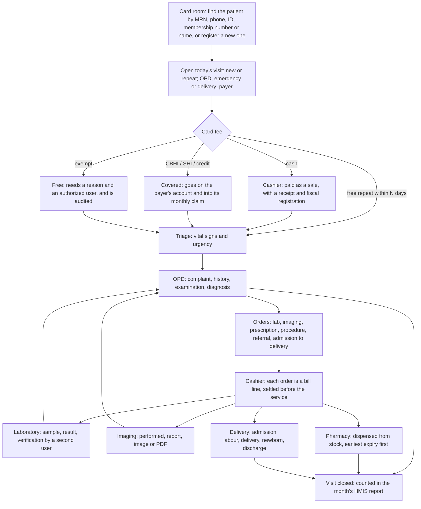

# Patient flow

## The payment rule

A service is not given until it is paid for or covered by the patient's payer. The one
exception is an emergency. A named, authorized user can mark it, and the mark is audited.

## Records made at each step

| Step | Record | Who |
|---|---|---|
| Registration | Patient: MRN, names, sex, date of birth or age, address, contact, payer | Card room |
| Visit | Visit: number, type, department, payer, arrival time, status | Card room |
| Payment | Charge settled: sale and receipt, payer cover, or exemption with reason | Cashier, or an authorizer for exemptions |
| Triage | Vital signs and urgency | Triage nurse |
| Consultation | Notes, diagnoses (new or repeat, primary or secondary), orders | Doctor |
| Laboratory | Sample, results, verification | Lab technician, then lab verifier |
| Imaging | Report and images | Radiographer |
| Pharmacy | Dispensing against the prescription | Pharmacist |
| Delivery | Labour and delivery register, newborn | Midwife |

## Dates

Dates are stored in the Gregorian calendar and shown in both the Ethiopian and Gregorian
calendars. A birth date may be entered in either calendar, or estimated from an age in years,
months and days.
